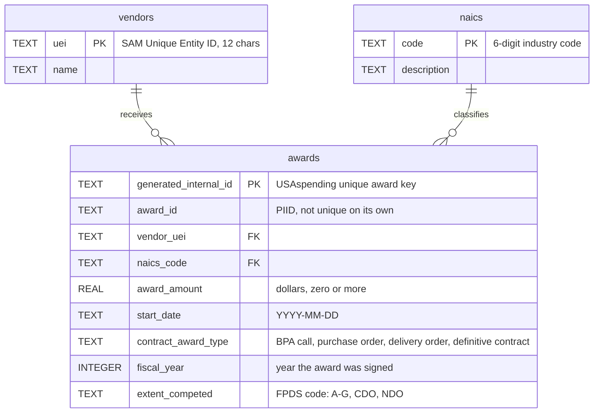

# federal-procurement-analytics
Pipeline and SQL analysis of US federal contract awards from the USAspending API.

## Questions

1. **Vendor Concentration** How much of the agency's contract dollars go to the top 10 vendors, and does concentration differ by contract category (NAICS)?
2. **Competition** What share of awards, by count and by dollars, were competed versus not competed, and how did that change across fiscal years?

## Scope

- Agency: NASA
- Fiscal years: 2022-2024
- Award types: contracts (excludes grants, loans, and other assistance)
- Source: [USAspending API](https://api.usaspending.gov/)

## Status

Work in progress. Schema is done ([schema.sql](schema.sql)); the loader comes next.

## Schema

Three SQLite tables. Each raw API record is one award; the vendor and NAICS details that repeat on every award are split into their own tables.

- **awards** is keyed on `generated_internal_id` because the same `award_id` can recur under a different parent contract.
- **vendors** is keyed on UEI, not name: one name can belong to several UEIs, and a UEI's name can change over time.
- **naics** codes are text so the leading digits can be used to roll up to sector.
- `extent_competed` is kept as the raw FPDS code; the meaning of each code is listed in [schema.sql](schema.sql).

## Definitions

An award is counted in a fiscal year if it was newly signed in that year (date_type: new_awards_only), not if it merely had a modification in that year. The default API behaviour would include the latter.

The API returns NAICS as a nested object with code and description; these are split into separate columns and stored in a naics reference table.